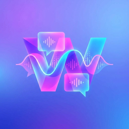

<p align="center">
  
</p>

<h1 align="center">Wisp</h1>

<p align="center">
  <strong>100% Offline Local AI Multi-Speaker Meeting Transcriber &amp; Translator</strong><br/>
  Cross-platform desktop application for Windows, macOS, and Linux (Ubuntu &amp; Fedora)
</p>

---

## Key Features

- **100% On-Device Local AI Pipeline (Zero Cloud)**:
  1. **Speaker Recognition & Diarization**: Automatically separates speakers (`Speaker 1`, `Speaker 2`, etc.) using local `3D-Speaker` ONNX voice embeddings, with voice sample playback, custom speaker naming, and a **Merge Speakers** dialog.
  2. **Speech-to-Text (ASR)**: Local INT8 `Sherpa-ONNX Whisper` models (`Tiny`, `Base`, `Small`, `Medium`, `Large-v3-Turbo`).
  3. **Local Neural Translation**: Specialized Helsinki-NLP `OPUS-MT` ONNX INT8 models (`Danish ↔ English`, `Spanish ↔ English`, `German ↔ English`) plus Meta `NLLB-200` (200 languages).
- **Per-Speaker Spoken Language Assignment**: Assign each speaker's spoken language (e.g. Speaker 1: Danish, Speaker 2: Spanish) and translate all speakers into a single target Output Language with retroactive re-processing.
- **MP3 / Audio File Import & Live Meeting Capture**:
  - Create **MP3 / Audio File** sessions (`.mp3`, `.wav`, `.flac`, `.ogg`) or **Live Meeting** sessions (listening in on Teams / Huddle / Zoom system loopback + microphone).
- **Word-Ready Plain Text Transcript**: Formatted as clean `Speaker:\nParagraph` blocks for one-click copy-paste into Microsoft Word, with an instant toggle between **Translated** and **Original Spoken (Untranslated)**.
- **First-Run Onboarding Wizard**: Guides new users through selecting a custom storage folder (`models/` and `sessions/`) and downloading the required local AI models.
- **Multi-Language UI & Theme Picker**: Interface available in English, Danish (`Dansk`), Spanish (`Español`), and German (`Deutsch`), with **Dark**, **Light**, and **System Match** themes.

---

## Building Desktop Executables

GitHub Actions (`.github/workflows/build.yml`) automatically builds standalone desktop installers on every push:

| Platform | Target Formats | Command |
| :--- | :--- | :--- |
| **Windows** | `.exe` (NSIS Installer & Portable) | `cd frontend && npm run dist:win` |
| **macOS** | `.dmg` & `.zip` | `cd frontend && npm run dist:mac` |
| **Linux (Ubuntu / Debian)** | `.deb` & `.AppImage` | `cd frontend && npm run dist:linux` |
| **Linux (Fedora / RHEL)** | `.rpm` | `cd frontend && npm run dist:linux` |

---

## Local Development

### 1. Python Backend (`Python 3.10+`)
```bash
pip install -r backend/requirements.txt
python backend/main.py
```

### 2. Electron + React Frontend
```bash
cd frontend
npm install
npm run build
npm run dev:electron
```
